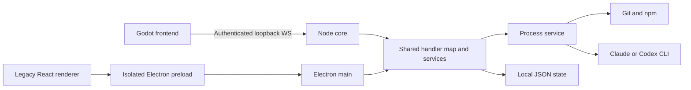

# Citybase architecture

## 1. Context and boundaries

The user opens one local working tree, reviews Git state as a city, and asks an
installed CLI to work in that tree. Citybase itself has no cloud account system,
database, server deployment or remote issue-tracker integration.

This is a component diagram, not a claim of per-run filesystem isolation.

## 2. Components

| ID | Owner | Responsibility |
|---|---|---|
| CMP-001 | `godot/` | Scene, city/camera, workbench, living layer, core lifecycle and WS client |
| CMP-002 | `core/server.cjs`, `rpcServer.cjs` | Construct services, authenticate loopback clients, route RPC, publish boot/events |
| CMP-003 | `electron/main/ipcHandlers.cjs` | Shared explicit capability map; resolve known workspace IDs before service calls |
| CMP-004 | `electron/main/services/` | Workspace registry, Git, checks, tracker projection and run storage |
| CMP-005 | `electron/main/agents/` | Provider selection, nonblocking lifecycle, approval, event stream and bounded history |
| CMP-006 | `processService.cjs` | Production Node subprocess invocation, timeout/output bounds and termination |
| CMP-007 | `electron/main/`, `electron/preload/`, `src/` | Legacy lifecycle/bridge and React hook-based presentation |

## 3. Runtime views

Godot discovers Node or a bundled core, sets a fresh token, and starts a core on
an OS-assigned port. A per-launch readiness file reports `{port,pid}` or an error
without the token. After authenticated WS connection, the core pushes boot state.
The profile lock prevents another core from owning the same state directory;
separate profiles permit concurrent instances.

Dispatch resolves the workspace ID in CMP-003, then CMP-005 returns a run handle
and waits for explicit UI approval before spawning CMP-006. Events flow back
through the transport. Settlement updates the shared record and persists a
bounded terminal summary. Review reads the current tree and declared checks.
On disconnection Godot preserves unknown outcomes and requires explicit retry;
requests are not automatically replayed.

## 4. Stack and deployment

### 4.1 Stack decision

| Tier | Language/runtime | Build/test tools | State |
|---|---|---|---|
| Primary presentation | GDScript, Godot 4.7.2 | Godot import/regression and real loopback harness | Detected |
| Shared core/services | JavaScript, CommonJS; Node 24.15+ in 24.x or Node 26.x | npm, ESLint, Vitest Node project | Detected |
| Legacy presentation | JavaScript/JSX, React 19, Electron | Vite, Vitest jsdom, Playwright Electron | Detected |
| Core transport | `ws` | RPC/startup integration tests | Only npm runtime dependency; React is bundled by Vite |
| Persistence | Platform user-data JSON files | Atomic-write/corruption/restart tests | No database/container |
| Godot distribution | macOS arm64 pipeline | Node SEA, esbuild, Godot export, codesign | Native Mac + Node with `--build-sea`; not a Windows packager |

`.nvmrc`, `package.json` and the lockfile own concrete versions. The supported
Node 26 packaging path is separate from the default Node 24 development pin.

## 5. Security and persistence

Electron's renderer has no Node access and sees only its preload bridge. Godot
talks to a token-gated loopback daemon; token possession grants the registered
capabilities. The app assumes one trusted local operator, not mutually
untrusted tenants. The RPC factory's injectable host exists for tests; production
construction uses the loopback default.

Workspace identity constrains renderer dispatch cwd. That directory is still a
real working tree. Approved CLI runs can edit it and run tools; approval is not a
transaction or rollback guarantee. The core lock covers cores, not concurrent
legacy Electron writers. JSON state is local plaintext, not encrypted storage.
Current renderer navigation/CSP gaps remain FEAT-006.

## 6. Decisions and risks

- ADR-001: Keep process/agent/Git logic in Node and use Godot as presentation,
  following the existing v4 charter. Retain Electron while native parity is open.
- ADR-002: Share one capability map and pure injected services across hosts;
  transport-specific UI code does not bypass service-side workspace validation.
- ADR-003: Use supported Node LTS lines and separate real Node tests from DOM
  component tests. Coverage reports measure the inspected source; no threshold
  is invented by this change.
- Limits requiring future work: recent-window progression, Codex event fidelity,
  initial camera framing, renderer hardening, final native distribution and
  complete current-platform manual parity. See the active trackers.

## Revision history

| Rev | Date | Commit | Mode | Summary |
|---|---|---|---|---|
| 1 | 2026-11-02 | pending | ADOPT | As-built components, boundaries and supported toolchain |
